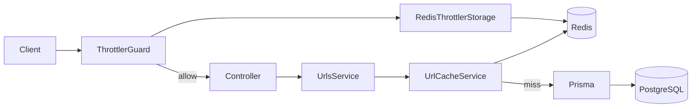

# url-shortener — 短網址服務

一個基於 **NestJS** 建構的 URL Shortening Service（短網址服務），靈感來自 [roadmap.sh](https://roadmap.sh) 的 URL Shortening Service 專案。提供長網址縮短、短碼重定向、點擊統計、Redis 快取與分散式請求限流等功能。

## 目錄

- [技術棧](#技術棧)
- [核心功能](#核心功能)
- [架構](#架構)
- [開始使用](#開始使用)
- [Redis 快取](#redis-快取)
- [請求限流](#請求限流)
- [失敗邊界](#失敗邊界)
- [效能基準](#效能基準)
- [專案結構](#專案結構)
- [開發 Roadmap](#開發-roadmap)

## 技術棧

| 類別              | 技術                             |
| ----------------- | -------------------------------- |
| 框架              | [NestJS](https://nestjs.com/) 12 |
| 語言              | TypeScript 6                     |
| 資料庫            | PostgreSQL 16                    |
| ORM               | Prisma 7                         |
| 快取 / 限流狀態   | Redis 7 + ioredis 6              |
| 限流              | `@nestjs/throttler` 6.7.1        |
| 容器化            | Docker + Docker Compose          |
| 靜態檢查 / 格式化 | oxlint + Prettier                |
| 測試              | Jest + Supertest                 |

## 核心功能

- **短網址生成** — `POST /api/urls`：提交長網址，產生唯一短碼並儲存（同一網址重複提交會回同一短碼）。
- **短網址重定向** — `GET /:shortCode`：依短碼查詢並以 `302` 重定向至原始網址，查無短碼回 `404`。
- **點擊統計** — `GET /api/urls/:shortCode/statistics`：回傳該短網址的建立／更新時間與累計點擊次數。
- **Redis 快取** — `GET /:shortCode` 與 `GET /api/urls/:shortCode` 共用讀取快取，命中時不查 DB。
- **分散式請求限流** — 依來源 IP 限制各端點頻率，計數存放於 Redis，多個 instance 共用；超額回 `429`。

## 架構

請求會先經過全域 `ThrottlerGuard`（以 Redis 計數），通過後才進入 controller 與 `UrlsService`。讀取短網址時由 `UrlCacheService` 先查 Redis，cache miss 才透過 Prisma 查 PostgreSQL。



## 開始使用

方式一、三、四只需要 Docker（Compose v2）；方式二另需 Node.js 24 與 npm。

### 1. 設定環境變數

複製範本，再依需求調整：

```bash
cp .env.example .env
```

`.env` 的設定分成四組。

**1. 資料庫**（兩者必須指向同一個資料庫）

- `DB_USERNAME` / `DB_PASSWORD` / `DB_DATABASE` / `DB_PORT` — 由 `docker-compose.yml` 讀取，用來建立容器內的資料庫；`DB_PORT` 是映射到本機的埠（只綁定 `127.0.0.1`）。
- `DATABASE_URL` — 由應用程式與 Prisma CLI 讀取，用來連線。**在宿主機執行時** host 填 `localhost`；在容器內執行時由 compose 覆寫成服務名 `db`，因此不需修改 `.env`。

**2. 伺服器**

- `PORT` — 開發環境對外映射的連接埠（預設 `3000`）；容器內的應用程式固定監聽 `3000`。

**3. Redis**

- `REDIS_URL` — 必填；本機使用 `redis://localhost:6379/0`，容器內由 compose 覆寫成服務名 `redis`；e2e / CI 使用 DB 15。
- `REDIS_PORT` — dev 映射到宿主機的埠（預設 `6379`，只綁定 `127.0.0.1`）。
- `REDIS_PASSWORD` — prod 的 `requirepass` 密碼，必填且必須是 URL-safe 字串。
- `URL_CACHE_TTL_MS` — URL 快取 TTL（毫秒），預設 `60000`。

**4. 請求限流**（詳見「請求限流」一節）

| 變數                      | 說明                     | 預設值  |
| :------------------------ | :----------------------- | :------ |
| `THROTTLE_TTL_MS`         | 計數視窗長度（毫秒）     | `60000` |
| `THROTTLE_LIMIT`          | 未被個別覆寫的端點之額度 | `30`    |
| `THROTTLE_WRITE_LIMIT`    | `POST /api/urls` 的額度  | `10`    |
| `THROTTLE_REDIRECT_LIMIT` | `GET /:shortCode` 的額度 | `60`    |

四個變數皆為選填，未設定時採用上表預設值。額度是在**每個請求**當下讀取環境變數後才解析，因此調整這些值只需重啟服務，不需要重新建置；計數本身存放於 Redis。

**正式環境**使用另一份 `.env.production`（從 `.env.production.example` 複製），需填 `DB_*`、`REDIS_PASSWORD`、`APP_PORT` 與限流參數；`DATABASE_URL` 與 `REDIS_URL` 由 `docker-compose.prod.yml` 以服務名組出，避免兩處設定不同步。Compose **不會自動載入** `.env.production`，所有指令都要帶 `--env-file`（見「方式四」）。

### 2. 方式一：全容器開發（推薦）

只需要 Docker：資料庫、Redis 與應用程式都在容器內，`src/`、`test/`、`prisma/` 以 bind mount 掛入，存檔即觸發 hot reload。

```bash
# 首次啟動：建置映像並啟動 db + redis + app
docker compose up --build

# 另開一個終端，套用遷移
docker compose exec app npx prisma migrate deploy
```

服務位址：`http://localhost:3000/api`；Redis 開發環境映射到 `127.0.0.1:6379`。

- 修改 `schema.prisma` 後產生遷移（遷移檔會寫回宿主機的 `prisma/`，並觸發容器內的 `prisma generate`）：
  ```bash
  docker compose exec app npx prisma migrate dev --name <名稱>
  ```
- 查看日誌：`docker compose logs -f app`、`docker compose logs -f db` 或 `docker compose logs -f redis`
- 確認 Redis：`docker compose exec redis redis-cli ping`
- 進入 psql：`docker compose exec db psql -U <DB_USERNAME> -d <DB_DATABASE>`
- 停止：`docker compose down`（保留資料卷）；`docker compose down -v`（**連資料一起刪除**）

### 3. 方式二：本機 Node + 容器化資料庫與 Redis

需要在宿主機上執行程式（除錯、IDE 整合）時使用。資料庫與 Redis 仍由 compose 提供，只啟動 `db` 與 `redis`：

```bash
cp .env.example .env            # 首次；compose 也要讀這份做插值
npm install
docker compose up -d db redis

npx prisma generate             # 產生 src/generated/prisma
npx prisma migrate deploy       # 套用 prisma/migrations
npm run start:dev
```

`.env` 的 `DATABASE_URL` 指向 `localhost:5432`，對應容器映射出來的埠；若改了 `DB_PORT`，連線字串裡的埠號也要同步。`REDIS_URL` 預設是 `redis://localhost:6379/0`；若改了 `REDIS_PORT`，也要同步調整。

> 服務啟動時**不會**自動執行遷移 —— `PrismaService` 只負責建立連線。忘記 `migrate deploy` 會在查詢時得到「資料表不存在」的錯誤。

### 4. 方式三：一鍵執行測試

```bash
docker compose -f docker-compose.test.yml run --rm --build test
```

在 test 映像內依序執行 `prisma migrate deploy` → 單元測試 → E2E 測試。資料庫使用 **tmpfs**（只存在記憶體），容器刪除後資料即消失，不會影響開發資料。test compose 也包含 Redis service；單元測試全部 mock Redis，E2E 連真 Redis，固定使用 DB 15，並在每個 test 前 `FLUSHDB`。`run` 會把容器的 exit code 傳回宿主機，可直接用於 CI。

`run --rm` 只會移除測試容器本身，`db` / `redis` 容器會留在背景；測試結束後清理：

```bash
docker compose -f docker-compose.test.yml down
```

CI 的 `E2E Tests` 與 `Docker` job 也都使用 Redis service；production image smoke test 以 `-e REDIS_URL` 注入。單元測試 job 不需要 Redis。

### 5. 方式四：正式環境

```bash
cp .env.production.example .env.production    # 填入 DB_PASSWORD、REDIS_PASSWORD 等實際值

# 1) 先套用遷移
docker compose --env-file .env.production -f docker-compose.prod.yml run --rm migrate

# 2) 再啟動應用程式
docker compose --env-file .env.production -f docker-compose.prod.yml up -d --build
```

- `migrate` 屬於 `tools` profile，平常的 `up` 不會執行它 —— **順序不能顛倒**，否則 app 會連上一個沒有資料表的資料庫。
- app 服務設有 healthcheck，`docker compose --env-file .env.production -f docker-compose.prod.yml ps` 應顯示 `healthy`。但它只確認 HTTP 服務已啟動（`GET /api` 不查資料庫），若漏跑遷移，`healthy` 照樣出現，實際打 API 才會回 `500`。
- Redis 以 `requirepass` 啟動，`REDIS_URL` 由 compose 以 `REDIS_PASSWORD` 組出；Redis 沒有資料卷，重啟後 cache / 限流狀態消失是預期行為。
- 停止：把 `up -d --build` 換成 `down`（預設保留 `postgres_prod_data` 資料卷）。

### 6. 容器開發注意事項

**容器內的 Prisma Client 要手動更新**

`/app/src/generated` 掛載匿名 volume，避免宿主機的空目錄蓋掉映像內已生成的 Client。代價是在宿主機執行 `npx prisma migrate dev` 後，容器內仍是舊版 Client：

```bash
docker compose exec app npx prisma generate
```

若遷移本身就是在容器內執行（`docker compose exec app npx prisma migrate dev`），這步會自動完成，不需額外處理。

反過來也成立：在容器內產生的 Client 不會回寫到宿主機，`src/generated` 仍是舊版。之後若改用方式二在宿主機執行程式，先跑一次 `npx prisma generate`。

**匿名 volume 不會隨重建刷新**

`docker compose up --build` 或 `restart` 都不會重新初始化 `/app/node_modules` 與 `/app/src/generated`。要重建這兩個目錄：

```bash
docker compose up --build --renew-anon-volumes
```

這不會影響 `postgres_data`；若連資料庫資料也要清掉才用 `down -v`。

**Windows / macOS 的檔案變更偵測**

Docker Desktop 的 bind mount 不會把宿主機的檔案事件轉發進容器，Nest 預設的 tsc watch 因此收不到變更。`docker-compose.yml` 已設定 `TSC_WATCHFILE` 與 `TSC_WATCHDIRECTORY` 改用輪詢。Linux 上事件轉發正常，可移除這兩行以降低 CPU 用量。

### 7. 其他常用指令

```bash
npm run lint          # 靜態檢查（oxlint）
npm run typecheck     # 型別檢查
npm run format        # 格式化程式碼（Prettier）
npm run test          # 單元測試（Jest）
npm run test:e2e      # 端對端測試（需 PostgreSQL + Redis DB15）
npm run build         # 編譯至 dist/

# Redis 除錯
docker compose exec redis redis-cli ping
docker compose exec redis redis-cli --scan --pattern 'url:*'
docker compose exec redis redis-cli --scan --pattern 'throttle:*'
```

## Redis 快取

Redis 在這個服務扮演兩個角色：URL 快取與分散式限流計數。本節聚焦快取；限流機制見「請求限流」，失敗時的行為見「失敗邊界」。

Redis 只存放可重建的狀態，不是 source of truth；prod 的 Redis 沒有掛載資料卷，重啟後 cache / 限流狀態消失是預期行為。

### 快取行為

- 讀取入口：`GET /:shortCode` 與 `GET /api/urls/:shortCode` 共用 `UrlsService.requireUrlRecord`
- key：`url:{shortCode}`
- value：JSON `{ id, originalUrl, shortCode, createdAt, updatedAt }`
- TTL：`URL_CACHE_TTL_MS`，預設 60000ms
- 預熱：`POST /api/urls` 建立或回傳既有 URL 時寫入
- 失效：`PUT` / `DELETE` 成功後刪除 key
- 不做負快取：404 不寫入
- 統計端點不快取
- 命中快取時仍會使用快取中的 `id` 寫入 `UrlClick`
- 沒有 production 的 cache-off 開關；效能量測時以獨立的測試 harness 關閉快取，數字與限制見「效能基準」

## 請求限流

以 [`@nestjs/throttler`](https://github.com/nestjs/throttler) 實作。`ThrottlerGuard` 以全域 Guard 註冊，因此**之後新增的端點會自動受保護**；追蹤鍵為來源 IP，計數存放於 **Redis**，由自寫的 `RedisThrottlerStorage` 以 Lua script 原子遞增，多個 app instance 共用同一組計數。Redis 故障時 fail-open（放行並記 warn），此時不提供嚴格限流；詳細邊界見「失敗邊界」。

| 端點                      | 預設額度        | 額度來源                                         |
| :------------------------ | :-------------- | :----------------------------------------------- |
| `POST /api/urls`          | 10 次 / 分 / IP | `THROTTLE_WRITE_LIMIT`（由 `@Throttle` 覆寫）    |
| `GET /:shortCode`         | 60 次 / 分 / IP | `THROTTLE_REDIRECT_LIMIT`（由 `@Throttle` 覆寫） |
| 其餘端點（含 `GET /api`） | 30 次 / 分 / IP | `THROTTLE_LIMIT`（模組層級的預設值）             |

計數是**逐路由**的：key 由 controller 與 handler 名稱組成，所以同一組 IP 打 `POST /api/urls` 與 `GET /api/urls/:shortCode` 各自獨立計數，不會互相消耗額度。視窗長度由 `THROTTLE_TTL_MS`（毫秒）決定，預設 60000。Redis key 前綴為 `throttle:` / `throttle:block:`；app 重啟不會清掉計數，需清 Redis 才會重置。

未被擋下的回應會帶上額度標頭；被擋下時則只帶 `Retry-After`：

| 標頭                    | 出現時機       | 說明                 |
| :---------------------- | :------------- | :------------------- |
| `X-RateLimit-Limit`     | 未被擋下的回應 | 該路由的額度上限     |
| `X-RateLimit-Remaining` | 未被擋下的回應 | 本視窗剩餘次數       |
| `X-RateLimit-Reset`     | 未被擋下的回應 | 視窗剩餘秒數         |
| `Retry-After`           | `429` 時       | 解除封鎖前的剩餘秒數 |

超過額度時回 `429 Too Many Requests`：

```json
{
  "statusCode": 429,
  "message": "Too many requests, please try again later."
}
```

這一層的界線是**擋單一來源的濫用**（例如腳本灌爆資料庫），但依賴 Redis；Redis 故障期間會暫時放行。

## 失敗邊界

快取與限流都採 **fail-open**：Redis 故障時不讓請求失敗，但會失去部分保護。

| 情境                           | 行為                              | 代價                          |
| :----------------------------- | :-------------------------------- | :---------------------------- |
| Redis 不可用                   | 快取回源 DB；限流放行；請求不 500 | 暫時沒有嚴格限流              |
| 快取 `set` / `invalidate` 失敗 | 只記 warn，不讓業務請求失敗       | 舊值可能留到 TTL 到期         |
| Redis 啟動時不可用             | app 仍可啟動，背景重連            | 開機初期沒有快取 / 分散式限流 |
| 多個 app instance              | 共用同一組 Redis 計數             | 需要 Redis 可用               |
| Redis 重啟                     | cache / throttle 狀態遺失         | 短暫冷啟動，狀態會重建        |

補充：

- `REDIS_URL` 必填；沒有 in-memory fallback
- 目前是單一 Redis，沒有 Cluster / HA
- 不做負快取
- cache 失效失敗時，靠短 TTL 保底

### 驗證 fail-open

```bash
docker compose stop redis
curl -i http://localhost:3000/api
docker compose start redis
```

停掉 Redis 後，重定向與 API 仍會回源 DB，限流暫時放行；log 會出現對應的 warn。E2E 不會用「停 Redis」來測，而是使用測試 client / harness。

## 效能基準

本機 hot-key（`GET /api/urls/:shortCode`、`autocannon -c 50 -d 10`）的相對比較：

| 情境      | Requests/sec |  p99 |
| :-------- | -----------: | ---: |
| Cache ON  |       ~4,190 | 22ms |
| Cache OFF |       ~3,460 | 27ms |

約 +21% 吞吐、-18% p99。這是單機 Docker 的 hot-key 量測，不是 SLA。

量測方式：production build、`autocannon -c 50 -d 10`、每個模式 3 次取中位數；cache off 使用測試 harness 覆寫 `UrlCacheService`。原始輸出保留在本機，未納入版本控制。

## 專案結構

```text
url-shortener/
├── prisma/
│   ├── migrations/              # 遷移檔（依時間命名）
│   └── schema.prisma
├── src/
│   ├── common/                  # ThrottledLogger
│   ├── generated/prisma/        # Prisma Client（gitignore，需執行 generate）
│   ├── prisma/                  # PrismaModule / PrismaService
│   ├── redis/                   # RedisModule / RedisService / error helper
│   ├── throttler/               # 全域限流、RedisThrottlerStorage
│   ├── urls/
│   │   ├── dto/                 # 請求與回應 DTO
│   │   ├── urls.controller.ts   # POST /api/urls、GET /api/urls/:shortCode/statistics
│   │   ├── redirect.controller.ts # GET /:shortCode
│   │   ├── urls.service.ts      # 建立短網址、查詢
│   │   ├── url-cache.service.ts # 快取讀寫與失效
│   │   └── analytics.service.ts # 點擊紀錄與統計
│   ├── app.module.ts
│   ├── main.ts
│   └── setup-app.ts             # 全域 pipe、路由前綴
├── test/                        # E2E 測試；需 PostgreSQL + Redis DB15
├── Dockerfile                   # Multi-stage：dev / test / builder / prod
├── docker-compose.yml           # 開發：db + redis + app（bind mount + hot reload）
├── docker-compose.test.yml      # 測試：tmpfs Postgres + Redis + 單元 + E2E
├── docker-compose.prod.yml      # 正式：prod 映像 + Redis + 顯式 migrate 服務
└── ...
```

## 開發 Roadmap

專案以 Git Flow 精神拆解為 8 個核心功能分支，依序開發：

1. `feature/init-setup` — **專案初始化與基礎環境**（✅）
   - NestJS 初始化、Linter & Formatter 設定、Docker 環境配置
2. `feature/prisma-database` — **資料庫架構與 Prisma 整合**（✅）
   - Prisma 安裝與初始化、定義 `Url` 模型、建立遷移檔、`PrismaModule` / `PrismaService`
3. `feature/url-shortening` — **核心功能：短網址生成 API**（✅）
   - `POST /api/urls`、URL 輸入驗證、短碼生成演算法、資料庫儲存
4. `feature/redirection` — **核心功能：短網址重定向**（✅）
   - `GET /:shortCode`、HTTP 301/302 重定向、404 錯誤處理
5. `feature/analytics` — **進階功能：點擊統計**（✅）
   - 重定向時記錄點擊事件、`GET /api/urls/:shortCode/statistics`
6. `feature/rate-limiting` — **安全防護：請求限流**（✅）
   - 整合 `@nestjs/throttler`、全域 `ThrottlerGuard`、逐路由額度並由環境變數驅動
7. `feature/dockerize-app` — **應用程式容器化**（✅）
   - Multi-stage Dockerfile（`dev` / `test` / `builder` / `prod`）
   - 三份 Compose：開發（hot reload）、一鍵測試（tmpfs Postgres）、正式環境（healthcheck + 顯式遷移）
   - 修正 Docker Desktop 下 bind mount 收不到檔案事件造成的 hot reload 失效
8. `feat/redis` — **Redis 快取與分散式限流**（✅）
   - URL read-through cache（warm / invalidate / no negative cache）
   - `RedisThrottlerStorage`（Lua 原子計數、多 instance 共用）
   - fail-open 邊界、e2e 隔離與分散式限流測試
   - CI Redis service、效能基準

## License

[MIT License](./LICENSE)
